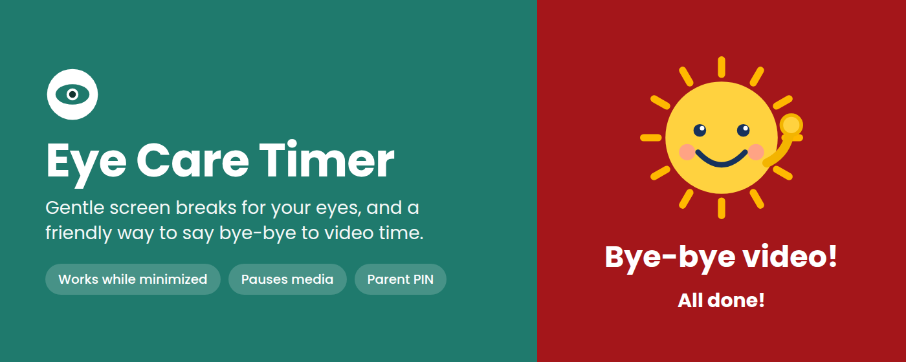
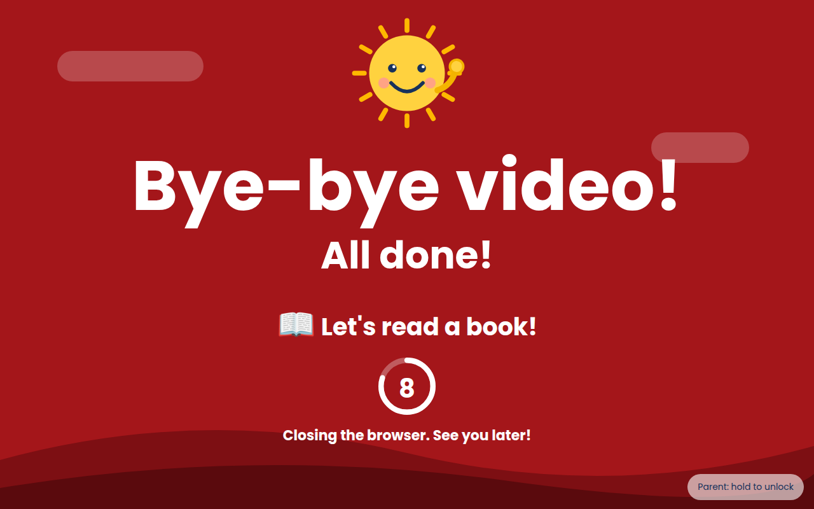
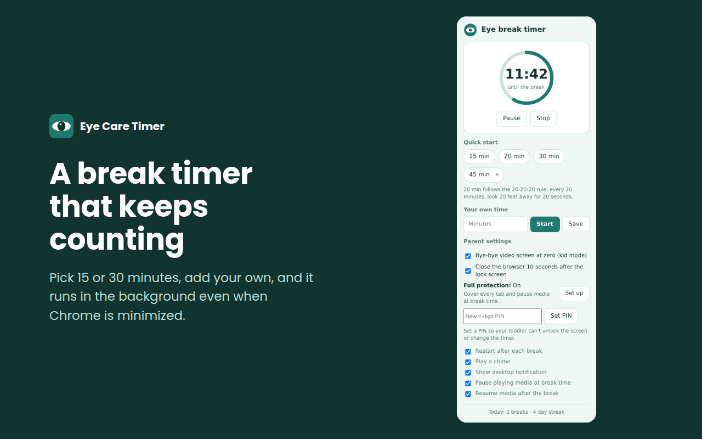
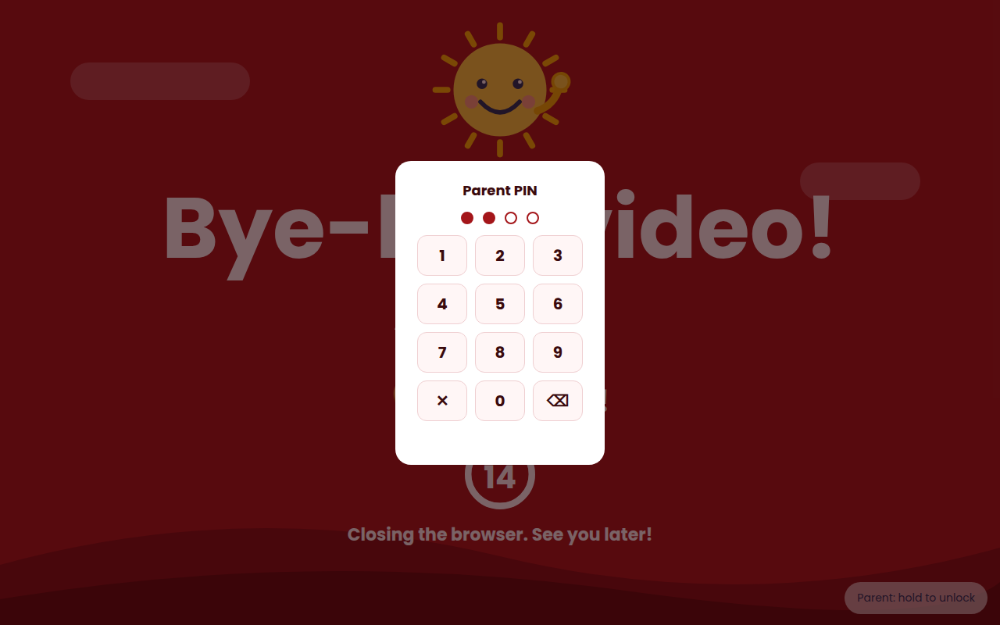
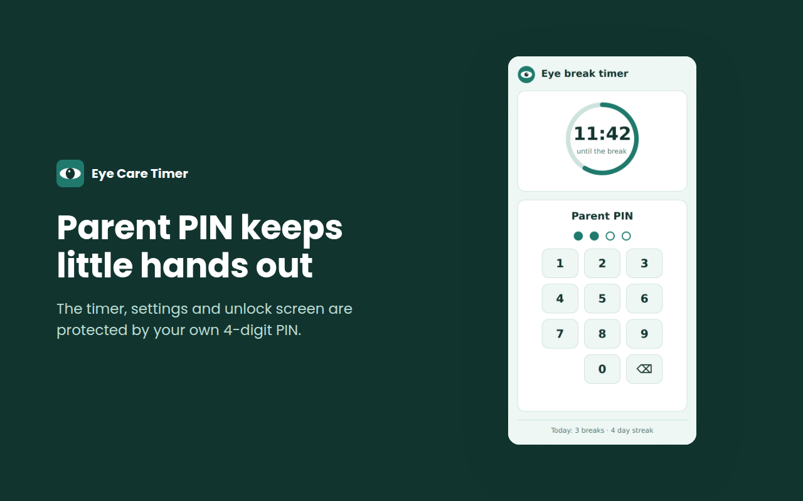
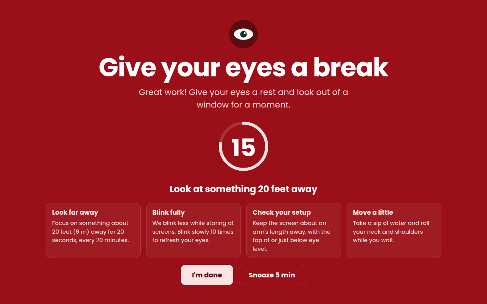

# Eye Care Timer



A Chrome extension (Manifest V3) that reminds you to rest your eyes, and gives parents a gentle way to end a toddler's video time.

When the timer reaches zero, it can show a friendly **"Bye-bye video! All done!"** screen with a 10-second countdown, then close all tabs and the browser. Or it can show a full-screen eye-health break with a 20-second look-away countdown.



## Features

**Timer**
- Quick-start presets (15, 20 and 30 minutes) plus any custom time, which you can save as your own preset
- Keeps running while the browser is minimized (uses `chrome.alarms`, not a page timer)
- Pause, resume and stop, with optional auto-restart after each break
- Live toolbar icon: a progress ring around an eye that shrinks as time runs out, with colors for normal, under 5 minutes, under 1 minute, paused and break time. The badge shows the minutes left
- Break and streak counter for the current day

**Kid mode ("Bye-bye video")**
- Full-screen window with a waving sun, "Bye-bye video! All done!", a random play idea and a countdown ring
- After 10 seconds it closes every tab, window and the browser
- Parent PIN (4 digits, stored as a salted SHA-256 hash). It protects the popup, the settings and the unlock screen
- Press-and-hold **Parent** button (1.5 s) so a toddler's tap does nothing, then enter the PIN to choose **10 more minutes** or **Close this screen**
- Keyboard input is swallowed while locked
- Wrong-PIN throttling: 5 wrong tries lock the keypad for 30 seconds

**Eye-health break (when kid mode is off)**
- Full-screen break with tips, a 20-second "look 20 feet away" countdown, an optional chime, and Snooze or Done buttons

**Full protection (optional)**
- Covers every open tab with the Bye-bye video screen and pauses playing video and audio (and resumes it if you choose)
- Needs access to all sites, which is requested only when you turn it on from the **Full protection** page. Without it, everything else still works

## Screenshots

| Timer popup | Parent keypad |
| --- | --- |
|  |  |
| **PIN-locked popup** | **Eye-health break** |
|  |  |

## Install (development)

1. Clone or download this repository.
2. Open `chrome://extensions` and turn on **Developer mode**.
3. Click **Load unpacked** and select the extension folder (the one containing `manifest.json`).

To get your toddler's browser into kid mode: open the popup, set a parent PIN under **Parent settings**, then start a timer.

## Usage

1. Click the toolbar icon and pick a preset or enter your own minutes.
2. Optional: set a PIN, and decide whether to close the browser after the lock screen.
3. When the timer ends, the break screen appears. Parents can hold **Parent**, enter the PIN and give 10 more minutes.

## Permissions

| Permission | Why |
| --- | --- |
| `alarms` | Runs the countdown so it fires while the browser is minimized |
| `storage` | Saves settings, timer state, presets, PIN hash and break counts locally |
| `notifications` | Shows a desktop notification when the timer ends |
| `scripting` | Used only after you opt in to Full protection, to pause media and draw the lock screen over open tabs |
| `optional_host_permissions` (`<all_urls>`) | Not requested at install. Requested only when you click **Allow access to all sites** on the Full protection page |

## Privacy

Nothing leaves your device. The extension makes no network requests and uses no analytics. It never reads, stores or sends page content. Settings, timer state, break counts and the PIN hash live in `chrome.storage.local`.

## Project structure

```
manifest.json      Extension manifest (MV3)
background.js      Service worker: timer, alarms, PIN checks, lock/close logic, media control
icon.js            Draws the live toolbar icon (OffscreenCanvas)
popup.html/css/js  Popup UI, PIN lock, settings
pinpad.js          Shared 4-digit keypad
kidscreen.js       "Bye-bye video" screen and 10-second countdown
lock.html          Full-screen window that hosts the kid screen
lock-page.js       Wires the lock window to storage and the close countdown
lock-content.js    Page overlay (registered only when Full protection is on)
reminder.html/js   Full-screen eye-health break
access.html/js     Page that requests or removes all-sites access
icons/             16, 48 and 128 px icons
```

## How it works

- The timer's end time is stored in `chrome.storage.local` and a `chrome.alarms` alarm fires at that time, which wakes the service worker even if the browser is minimized.
- At zero the worker sets a `locked` flag. The lock window and (with Full protection) the page overlays show the kid screen and react to storage changes, so unlocking one unlocks all.
- A `closeAt` timestamp drives the countdown. The worker closes all tabs and windows when it passes, with the lock page as a fallback trigger.
- PINs are verified only in the service worker. Lock screens send the PIN to it and never store it.

## Limitations

- An extension can be disabled. A determined child can turn it off at `chrome://extensions`, use Incognito (unless allowed), or use another browser or device. For real control, pair it with Chrome profiles, Family Link, Apple Screen Time or router controls.
- Closing the browser can lose unsaved work in open tabs. The feature can be switched off in Parent settings.
- On macOS, Chrome keeps running with no windows open. Some Chrome settings can reopen tabs on the next launch.
- A forgotten PIN can't be recovered. Remove and re-add the extension to reset it.

## Publishing to the Chrome Web Store

1. Zip the extension folder so `manifest.json` is at the zip's root (not inside a subfolder).
2. Upload it in the Chrome Web Store Developer Dashboard (one-time registration fee applies).
3. Fill in the listing, privacy practices and permission justifications. Ready-to-paste copy is in `store-listing.md`, and the images are in `store-assets/`.

## Contributing

Issues and pull requests are welcome. Please keep the extension free of network requests and third-party code.

## License

Add your license here (for example MIT) and replace this line.
