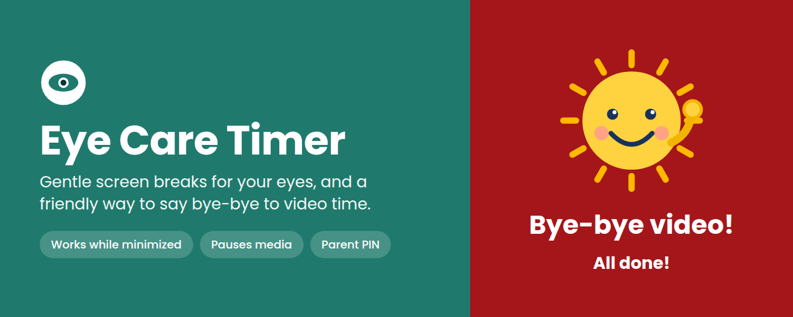
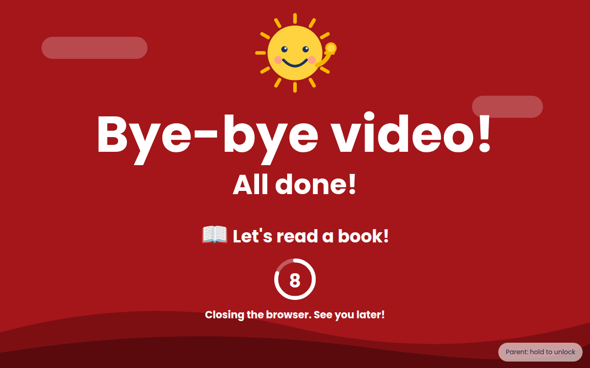
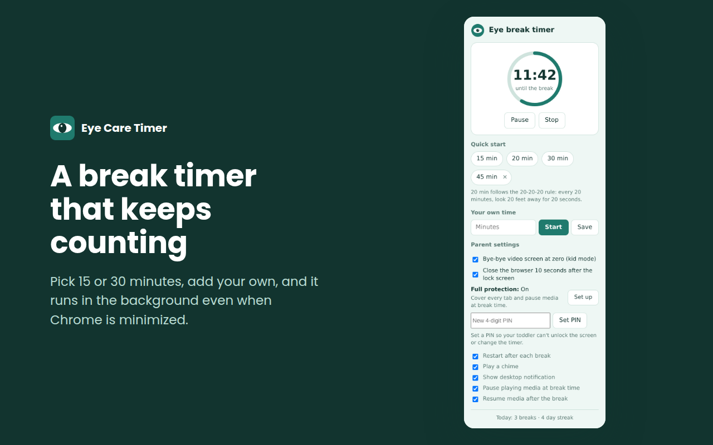
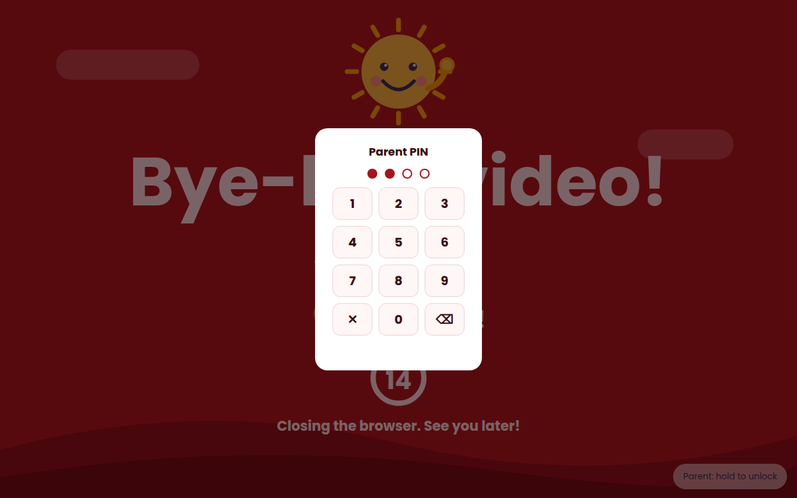
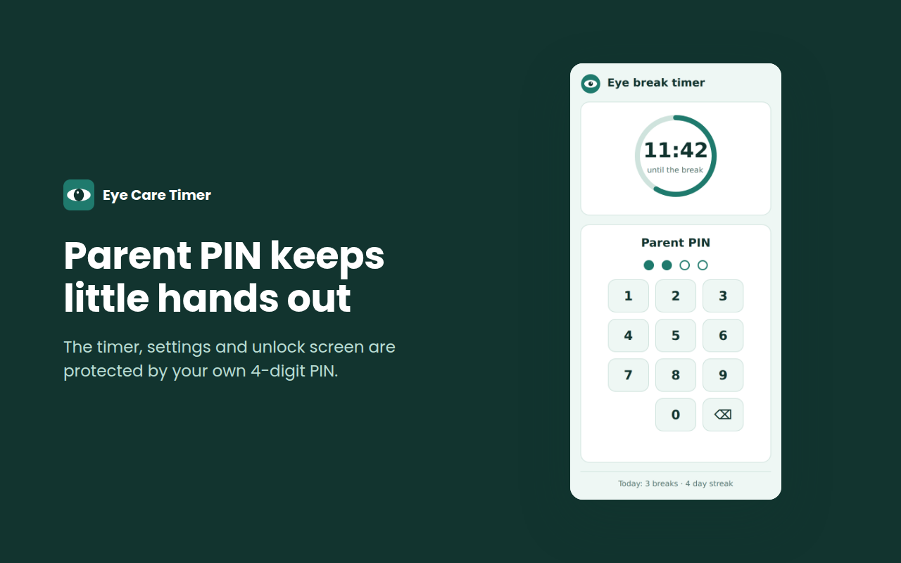
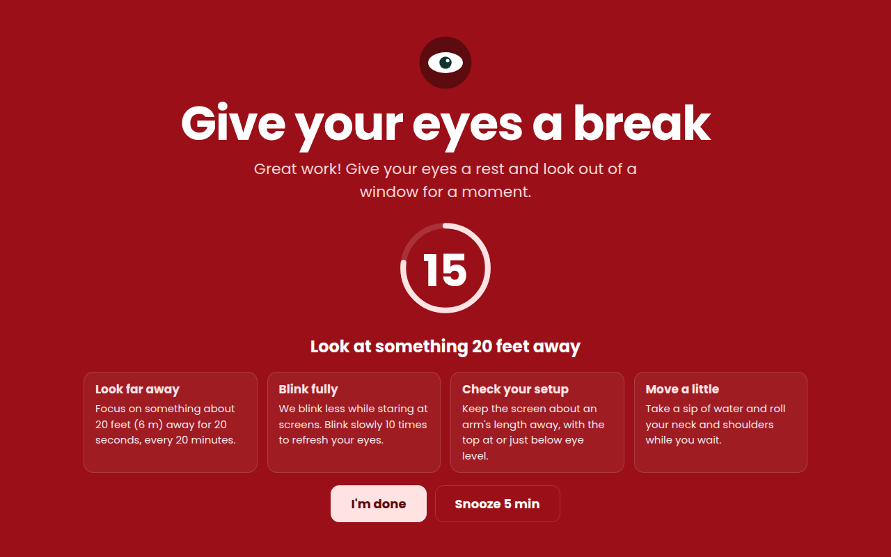

# Eye Care Timer



A Chrome extension (Manifest V3) that reminds you to rest your eyes, and gives parents a gentle way to end a toddler's video time.

When the timer reaches zero, it can show a friendly **"Bye-bye video! All done!"** screen with a 10-second countdown, then close all tabs and the browser. Or it can show a full-screen eye-health break with a 20-second look-away countdown.



## Features

**Smart Timer & Ergonomics**
- Tabbed interface: **Timer**, **Exercises**, **Insights**, and **Settings**
- Quick-start presets (15, 20 and 30 minutes) plus custom saved presets
- **Smart Idle & Auto-Pause (`chrome.idle`)**: pauses when you leave your desk; auto-resets after a 10-minute natural break away from the screen
- **Meeting & Presentation Shield**: detects active calls on Google Meet, Zoom, Teams, Webex and defers breaks by 5 minutes without disrupting you
- **Break Delivery Options**: choose between **Immersive Fullscreen** or an unobtrusive **Gentle Floating HUD** banner
- **Screen Warmer (Blue Light Tint)**: injects customizable warm amber tint directly in tabs to relieve evening eye strain
- Keeps running while the browser is minimized (uses `chrome.alarms`)
- Live toolbar icon: progress ring around a blinking eye with state colors (normal emerald, under 5m amber, under 1m red, paused slate)
- Keyboard shortcuts: `Alt+Shift+E` (Take break now), `Alt+Shift+P` (Pause/Resume)
- 2-minute heads-up notification before break time

**Guided Eye Exercises & Restorative Break Screen**
- Deep, calming oceanic emerald palette designed for visual relaxation
- 5 interactive pacer modes:
  - **20-20-20 Rule**: classic 20-second distance gaze
  - **Breathing Orb**: 4-2-4 rhythmic pulsing orb to ease tension
  - **Infinity Tracker**: smooth pursuit figure-8 path for ocular muscle relief
  - **Blink Gym**: 10 guided slow blinks to replenish natural tear film
  - **Desk & Posture Reset**: guided 4-step stretches for neck, shoulders, wrists, and hydration
- **Spoken Voice Guidance Coach**: gentle audio cues for exercises and rest transitions
- Synthesized audio via Web Audio API: **Tibetan Singing Bowl**, **Zen Bell**, or **Classic Chime**
- Synthesized ambient surf/rain soundscape toggle during breaks

**Kid Mode ("Bye-bye video")**
- Day & Night themes:
  - **Sunny Day**: cheerful sun, waving hand, rolling hills, play ideas
  - **Sleepy Bedtime**: crescent moon, twinkling stars, bedtime ideas
- **Daily Screen-Time Budget**: enforce a daily allowance (e.g., 30m, 45m, 60m) tracked automatically
- **Bedtime Curfew Lock**: automatically locks during scheduled sleep hours (e.g., 20:00 to 07:00)
- **Gentle Volume Fade**: lowers video volume smoothly during the 2-minute pre-warning to prevent sudden-cutoff tantrums
- Offline speech synthesis prompt ("Bye-bye video! All done! Great job!")
- Confetti celebration and countdown ring
- 10-second automatic browser close
- Parent PIN (4 digits, salted SHA-256 hash) with 1.5-second hold button and wrong-PIN lockout throttling

**Insights & Habit Analytics**
- **Eye Health Score (0–100)**: holistic rating evaluating break frequency, streak consistency, and compliance
- 7-day visual consistency bar chart with daily break counts
- Multi-day streak tracker and protected screen-time hours
- Break compliance rate (taken vs snoozed)
- **Export & Reset**: export habit data to JSON for backup or optometrist review, and reset history anytime

**Full Protection (optional)**
- Covers every open tab, pauses playing media, and powers the in-browser Screen Warmer and Gentle Volume Fade
- Requires optional host permissions requested only upon opt-in

## Screenshots

| Timer popup | Parent keypad |
| --- | --- |
|  |  |
| **PIN-locked popup** | **Eye-health break** |
|  |  |

## Install (development)

1. Clone or download this repository.
2. Open `chrome://extensions` and turn on **Developer mode**.
3. Click **Load unpacked** and select the extension folder (the one containing `manifest.json`).

To get your toddler's browser into kid mode: open the popup, set a parent PIN under **Parent settings**, then start a timer.

## Usage & Configuration Guide

### ⏱️ Setting Up Your Focus Cadence
1. Click the Eye Care Timer toolbar icon.
2. Choose a quick preset (**15m**, **20m**, **30m**) or input a custom interval and click **Start** (or **+ Save** to add it to your chips).
3. The live toolbar icon reflects your remaining time with a circular progress ring and state colors (emerald $\to$ amber under 5m $\to$ red under 1m $\to$ slate when paused).

### 🧘 Exercise Pacer Modes
Switch between 5 scientifically backed recovery routines in the **Exercises** tab or on the break screen:
- **🔭 20-20-20 Rule**: Relax ciliary muscles by shifting focus to an object 20 feet away for 20 seconds.
- **🌬️ Breathing Orb**: 4-2-4 respiratory pacer (inhale 4s, hold 2s, exhale 4s) to calm heart rate and facial tension.
- **♾️ Infinity Tracker**: Smooth pursuit visual tracker following a continuous figure-8 path to release ocular tension.
- **💧 Blink Gym**: 10 guided slow, deliberate blinks to refresh and restore your natural tear film.
- **🧘 Desk & Posture Reset**: Guided 4-step physical reset covering lateral neck releases, shoulder & chest openers, wrist extensions, and hydration.
- **🗣️ Voice Coach**: Spoken cues via the Web Speech API can guide you hands-free through each exercise.

### 🛡️ Smart Focus & Ergonomics Settings
- **Smart Idle Auto-Pause (`chrome.idle`)**: The timer pauses automatically when you lock your screen or walk away from your desk.
- **Natural Break Auto-Reset**: When enabled, spending $\ge 10$ minutes away from your screen is automatically recognized as a completed natural break, refreshing the timer cycle for your return.
- **Meeting & Presentation Shield**: Detects active video calls and screen shares on Google Meet, Zoom, Microsoft Teams, Webex, and others, postponing eye breaks by 5 minutes to prevent awkward interruptions.
- **Break Delivery**: Toggle between **Immersive Fullscreen** (deep visual disconnect) and **Gentle Floating HUD** (unobtrusive 20s pill at top of screen that never steals typing focus).
- **Screen Warmer (Blue Light Filter)**: Injects an amber color tint with adjustable warmth (15% to 60%) to relieve late-night digital eye strain.
- **Audio Themes**: Synthesized on-the-fly using the Web Audio API (**Tibetan Singing Bowl**, **Zen Bell**, or **Classic Chime**) plus an optional procedural surf/rain ambient generator.

### 🧸 Kid Mode ("Bye-bye video") & Parental Controls
1. Turn on **Kid screen lock at zero** and select a theme (**☀️ Sunny Day** or **🌙 Sleepy Bedtime**).
2. Set a 4-digit **Parent PIN** (salted SHA-256 hash).
3. **Daily Allowance Budget**: Set a total daily screen-time limit (e.g. 45 min/day). A progress meter in the popup tracks usage, and locks the browser when the quota is reached.
4. **Bedtime Curfew**: Define sleep hours (e.g. 20:00 to 07:00). During curfew, the extension forces bedtime mode and blocks video playback without the parent PIN.
5. **Gentle Volume Fade**: Tab video/audio volume gradually ramps down to 25% during the 2-minute pre-warning, gently preparing toddlers for screen shutoff.
6. **Browser Close Countdown**: Optional 10-second countdown after timer expiration that closes all tabs and browser windows.

---

## Technical Highlights (Manifest V3)

- **100% Offline & Private**: Zero network calls, zero tracking analytics, zero telemetry. All state, PIN hashes, and analytics live in `chrome.storage.local`.
- **Pure Web Audio Synthesizer**: No external audio files or MP3s to load; chimes and ambient pink noise are synthesized directly in code.
- **OffscreenCanvas Toolbar Rendering**: Renders real-time animated eye states and progress rings onto Chrome's extension action icon.
- **Shadow DOM Isolation**: Both the Full Protection overlay and the Gentle Mode HUD banner use isolated shadow roots to prevent host page CSS collisions.
- **Hardware-Resilient Countdown**: Driven by timestamps stored in local storage and backed by `chrome.alarms`, allowing the timer to survive service worker deactivations and browser minimization.

## Permissions

| Permission | Why |
| --- | --- |
| `alarms` | Runs the countdown so it fires while the browser is minimized |
| `storage` | Saves settings, timer state, presets, PIN hash, and analytics locally |
| `notifications` | Shows a desktop notification when the timer ends or pre-warns |
| `idle` | Detects when you step away from the desk to auto-pause and auto-reset the timer |
| `scripting` | Used to pause media, apply the Screen Warmer tint, and display break HUDs over open tabs |
| `optional_host_permissions` (`<all_urls>`) | Not requested at install. Requested only when you click **Allow access to all sites** on the Full protection page |

## Privacy

Nothing leaves your device. The extension makes no network requests and uses no analytics. It never reads, stores or sends page content. Settings, timer state, break counts and the PIN hash live in `chrome.storage.local`.

## Project structure

```
manifest.json      Extension manifest (MV3)
background.js      Service worker: timer, idle detection, alarms, PIN checks, lock/close logic, media control
icon.js            Draws the live toolbar icon (OffscreenCanvas)
popup.html/css/js  Popup UI, PIN lock, analytics, and settings
pinpad.js          Shared 4-digit keypad
kidscreen.js       "Bye-bye video" screen and 10-second countdown
lock.html          Full-screen window that hosts the kid screen
lock-page.js       Wires the lock window to storage and the close countdown
lock-content.js    Page overlay (registered only when Full protection is on)
gentle-banner.js   Non-intrusive floating HUD for Gentle Mode breaks
screen-warmer.js   In-browser warm amber blue light filter layer
reminder.html/js   Full-screen eye-health break, pacer exercises & voice coach
access.html/js     Page that requests or removes all-sites access
icons/             16, 48 and 128 px icons
```

## How it works

- The timer's end time is stored in `chrome.storage.local` and a `chrome.alarms` alarm fires at that time, which wakes the service worker even if the browser is minimized.
- At zero the worker sets a `locked` flag. The lock window and (with Full protection) the page overlays show the kid screen and react to storage changes, so unlocking one unlocks all.
- A `closeAt` timestamp drives the countdown. The worker closes all tabs and windows when it passes, with the lock page as a fallback trigger.
- PINs are verified only in the service worker. Lock screens send the PIN to it and never store it.

## Limitations

- An extension can be disabled. A determined child can turn it off at `chrome://extensions`, use Incognito (unless allowed), or use another browser or device. For real control, pair it with Chrome profiles, Family Link, Apple Screen Time or router controls.
- Closing the browser can lose unsaved work in open tabs. The feature can be switched off in Parent settings.
- On macOS, Chrome keeps running with no windows open. Some Chrome settings can reopen tabs on the next launch.
- A forgotten PIN can't be recovered. Remove and re-add the extension to reset it.

## Publishing to the Chrome Web Store

1. Zip the extension folder so `manifest.json` is at the zip's root (not inside a subfolder).
2. Upload it in the Chrome Web Store Developer Dashboard (one-time registration fee applies).
3. Fill in the listing, privacy practices and permission justifications. Ready-to-paste copy is in `store-listing.md`, and the images are in `store-assets/`.

## Contributing

Issues and pull requests are welcome. Please keep the extension free of network requests and third-party code.

## License

Add your license here (for example MIT) and replace this line.
